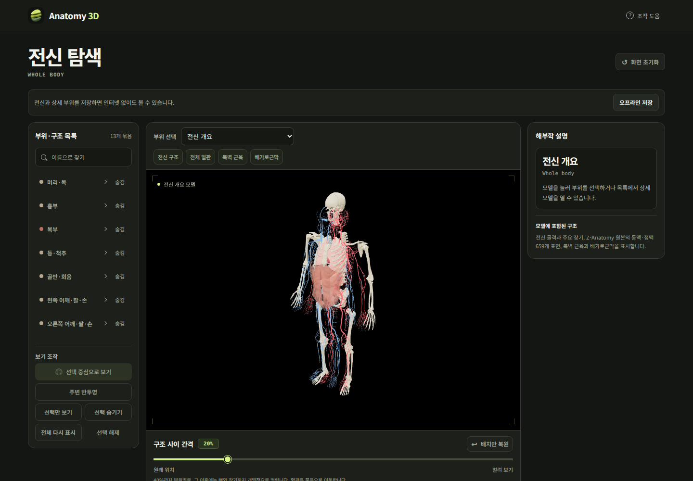
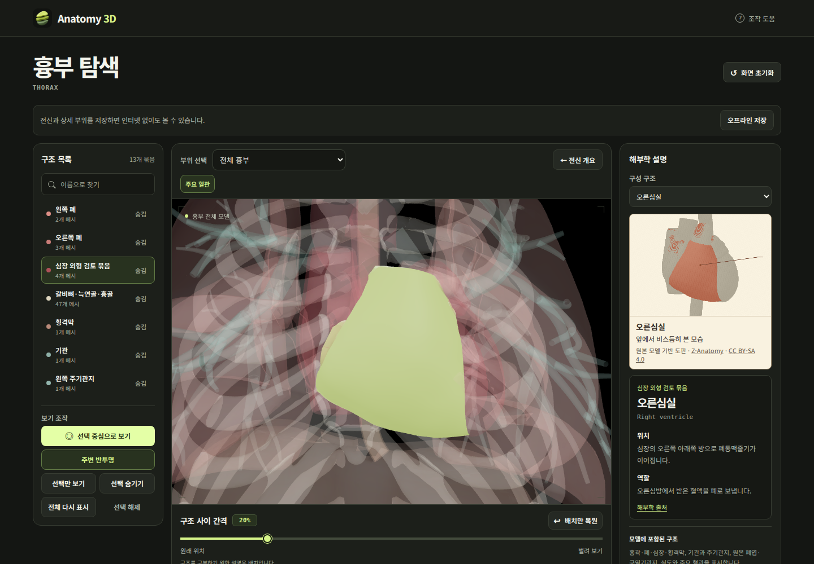
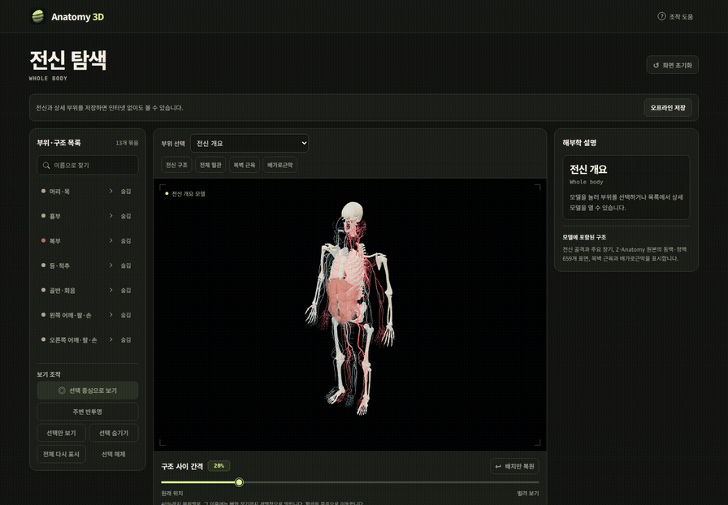
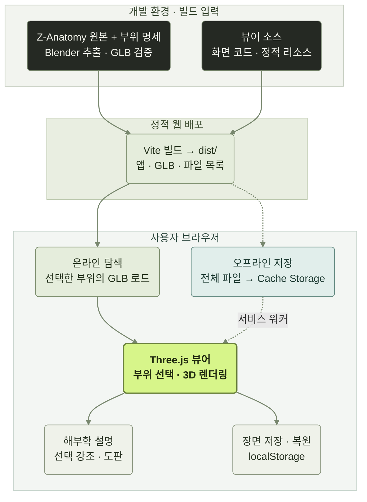

# Anatomy 3D · 전신 해부학 뷰어

| 전신 탐색 | 흉부 상세 · 오른심실 |
| --- | --- |
| [](docs/media/whole-body.png) | [](docs/media/right-ventricle.png) |

**[시연 영상 보기 · MP4, 13초](docs/media/anatomy-demo.mp4)** — 전신 모델을 돌려 본 뒤 흉부로 이동합니다. 심장을 선택하고 주변 조직을 반투명하게 바꿔 오른심실을 확대합니다.

<details>
<summary>README에서 시연 재생하기</summary>



</details>

화면과 영상은 실제 뷰어에서 캡처했습니다. 모델 원본은 Z-Anatomy와 BodyParts3D이며, 개별 구조의 제공자와 이용 조건은 [출처와 라이선스](#출처와-라이선스)에 기재했습니다.

## 프로젝트 소개

인체를 돌려 보며 구조 사이의 위치 관계를 살펴보고, 원하는 장기·근육·뼈·혈관을 골라 다른 사람에게 설명하는 웹 앱입니다. 첫 화면에는 전신 구조와 혈관이 함께 표시됩니다. PC와 휴대폰에서 사용하며, 빌드된 앱에서는 모델을 기기에 저장해 오프라인으로도 탐색할 수 있습니다.

**이 프로젝트는 비상업적 학습과 해부학 설명을 목적으로 사용합니다.**

현재 버전은 내부 검토용 시제품입니다. 전신 개요와 9개 상세 부위를 구현했고, 실물 휴대폰 검증과 해부학 전문가 검수가 남아 있습니다. 웹 공개와 앱 스토어 등록은 검증 이후의 목표입니다. [출시 계획](docs/08-release-plan.md) · [검증 기록](docs/23-follow-up-verification.md)

## 기능 설명

- **부위 탐색** — 전신에서 머리·목, 흉부, 복부, 등·척추, 골반·회음, 좌우 팔·손과 좌우 다리·발로 이동합니다. 전신 구조와 혈관은 각각 켜고 끌 수 있습니다.
- **구조 관찰** — 목록이나 모델에서 구조를 선택하면 해부학 도판과 설명이 표시됩니다. 안쪽에 가려진 구조는 주변을 반투명하게 하거나 선택한 구조만 남겨 확인할 수 있습니다.
- **배치 조절** — 기본 간격은 20%입니다. 전신에서는 40%까지 부위별로 벌어지고, 그 이후에는 뼈와 장기도 개별적으로 벌어집니다. 혈관은 묶음으로 이동합니다. **배치만 복원**을 누르면 원래 위치로 돌아갑니다.
- **설명 장면 저장** — 선택한 구조, 표시 상태, 간격, 카메라 시점을 브라우저에 저장하거나 링크로 공유합니다. 현재 모델 화면은 PNG로 내보낼 수 있습니다.

## 로컬 실행

Node.js 22.12 이상을 사용하는 환경을 기준으로 합니다. **처음 복제한 경우에는 모델 준비가 먼저 필요합니다.** 원본 Blender 파일과 생성된 GLB는 Git에서 제외됩니다. 이미 이 작업 공간에 `research/samples/regions/`의 GLB와 검증용 JSON이 있다면 바로 실행할 수 있습니다. [원본 확보와 부위별 모델 생성 방법](research/README.md#전신-및-부위별-자산)

```sh
npm ci
npm run dev
```

기본 개발 주소는 `http://127.0.0.1:5173`입니다. 개발 서버 시작과 빌드 직전에 `npm run assets`가 모델을 검사하고 `public/models/`에 복사합니다.

**오프라인 저장 확인**에는 프로덕션 빌드를 사용합니다.

```sh
npm run build
npm run preview -- --port 4174 --strictPort
```

`http://127.0.0.1:4174`에서 **오프라인 저장**을 누르면 전신과 모든 상세 부위, 글꼴 등 실행에 필요한 파일이 해당 브라우저에 저장됩니다. 저장 완료 후 네트워크를 끊어 다른 부위로 전환해 볼 수 있습니다. 휴대폰 홈 화면에 앱 아이콘을 추가하는 작업은 브라우저의 설치 메뉴에서 별도로 진행합니다.

## 파일 구조

```text
anatomy-3d/
├── index.html                     뷰어 화면과 조작 패널
├── src/
│   ├── main.js                    화면 이벤트, 모델 로딩, 카메라와 렌더링
│   ├── model.js                   메시 선택·표시, 그룹별 간격과 배치 복원
│   ├── anatomy-content.js         구조별 한국어 이름, 위치·역할 설명과 출처
│   ├── anatomy-plate.js           선택한 모델 표면에서 해부학 도판 생성
│   ├── scene-state.js             설명 장면의 저장·공유에 쓰는 상태 형식과 검증
│   ├── offline.js                 오프라인 파일 다운로드, 검증과 저장
│   └── style.css                  PC·모바일 레이아웃과 테마
├── public/
│   ├── models/                    검사가 끝난 뷰어용 GLB (생성됨)
│   ├── manifest.json              홈 화면 앱의 이름, 아이콘, 시작 주소
│   └── offline-worker.js          저장한 앱과 파일을 제공하는 서비스 워커
├── research/
│   ├── raw/                       내려받은 원본 모델 (로컬)
│   ├── samples/regions/           부위별 GLB와 내보내기 검증 기록 (생성됨)
│   ├── results/region-manifest.json  부위·구조·원본 메시 대응표
│   └── scripts/prepare_regions.py    Blender 원본에서 부위별 모델 추출
├── scripts/prepare-viewer-assets.mjs  내보낸 파일 검사와 뷰어 자산 복사
├── vite.config.js                 빌드 설정과 오프라인 파일 목록 생성
├── tests/                         모델 단위 테스트와 브라우저 조작 테스트
├── docs/                          기획, 모델 선정, 구현과 검증 기록
└── dist/                          배포할 정적 웹 앱 (빌드 시 생성됨)
```

## 시스템 아키텍처

개발 환경에서 부위별 모델을 준비하면 정적 웹 서버가 앱과 모델을 제공합니다. 모델 선택·렌더링과 오프라인 저장은 사용자 브라우저에서 처리합니다.



- **모델 준비** — Blender 스크립트는 부위 명세가 지정한 원본 오브젝트를 같은 좌표계로 내보냅니다. 자산 준비 스크립트가 GLB의 크기와 SHA-256을 내보내기 기록과 대조한 뒤 뷰어에 복사합니다. [부위 명세](research/results/region-manifest.json) · [자산 준비 코드](scripts/prepare-viewer-assets.mjs)
- **선택과 설명** — 처음에는 전신 GLB를 불러오고, 상세 부위로 이동할 때 해당 GLB를 요청합니다. 목록과 3D 화면은 같은 메시 묶음을 선택하므로 강조한 구조와 오른쪽 설명이 대응합니다. 도판은 모델을 벌려 놓아도 원래 배치를 기준으로 그립니다. [뷰어 진입점](src/main.js) · [도판 생성 코드](src/anatomy-plate.js)
- **오프라인 전환** — Vite가 빌드 결과로 생성한 `offline-files.json`이 저장 대상과 해시를 지정합니다. 앱은 새 파일 묶음을 모두 받고 무결성 검사를 마친 뒤 활성 저장본을 교체합니다. 다운로드가 중단되면 이전에 완료한 저장본을 계속 사용할 수 있습니다. [오프라인 저장 코드](src/offline.js) · [서비스 워커](public/offline-worker.js)

## 검증 명령

| 명령 | 확인 범위 |
| --- | --- |
| `npm test` | 모델 선택·표시와 배치 계산 등 모델 로직 |
| `npm run test:browser` | Playwright로 데스크톱과 모바일 에뮬레이션에서 뷰어 조작 확인 |
| `npm run test:production` | 빌드된 앱의 부위별 모델 로딩과 오프라인 탐색 확인 |

브라우저 테스트를 처음 실행할 때는 `npx playwright install chromium`으로 테스트용 브라우저를 설치합니다. 프로덕션 검사는 위의 4174번 미리보기 서버를 실행해 둔 상태에서 다른 터미널로 진행합니다.

## 출처와 라이선스

### 3D 모델과 해부학 도판

전신·상세 부위·경량 폐 모델은 Z-Anatomy의 Blender 원본에서 구조를 골라 GLB로 변환했습니다. 일부 표면은 단순화했고 혈관 곡선은 메시로 변환했습니다. 뷰어의 도판은 이 표면을 투영한 뒤 음영, 강조색, 지시선과 한국어 라벨을 더해 그립니다. [사용한 원본 버전](https://github.com/Z-Anatomy/Models-of-human-anatomy/tree/d909eb1e89bf47180b575e4dfacce639c90044b8) · [원본 저작자·라이선스 고지](https://github.com/Z-Anatomy/Models-of-human-anatomy/blob/d909eb1e89bf47180b575e4dfacce639c90044b8/License.txt) · [다운로드 파일과 해시](research/source-manifest.json)

| 자료 | 저작자·제공자 | 적용 범위와 출처 |
| --- | --- | --- |
| Z-Anatomy — The libre 3D atlas of anatomy | Gauthier Kervyn과 Z-Anatomy 기여자 | 뷰어의 3D 모델과 도판의 기반입니다. 아틀라스의 기본 조건은 CC BY-SA 4.0이며, 개별 외부 자료는 아래 원본 고지를 따릅니다. [프로젝트](https://www.spi-inc.org/projects/z-anatomy/) · [CC BY-SA 4.0](https://creativecommons.org/licenses/by-sa/4.0/) |
| BodyParts3D | Kousaku Okubo, The Database Center for Life Science | Z-Anatomy의 기반 모델이며 초기 흉부 OBJ 검사에도 사용했습니다. 고정된 Z-Anatomy 원본과 확보한 OBJ에는 CC BY-SA 2.1 Japan이 표시돼 있습니다. 현재 배포처가 지정한 표기는 “BodyParts3D, © The Database Center for Life Science licensed under CC Attribution 4.0 International”입니다. [원본 다운로드](https://dbarchive.biosciencedbc.jp/en/bodyparts3d/download.html) · [배포처 고지](https://dbarchive.biosciencedbc.jp/en/bodyparts3d/lic.html) · [CC BY-SA 2.1 JP](https://creativecommons.org/licenses/by-sa/2.1/jp/) · [CC BY 4.0](https://creativecommons.org/licenses/by/4.0/) |
| Brainder, White matter | University of Washington (Z-Anatomy 원본 표기) | 머리·목의 백질과 관련된 자료입니다. 원본 고지에는 별도 라이선스명이 없으며, 개별 메시의 이용 범위는 확인 중입니다. [원본 프로젝트의 확인 이슈](https://github.com/Z-Anatomy/Models-of-human-anatomy/issues/10) |
| Cranial Nerves and Foramina | University of Dundee, Centre for Anatomy and Human Identification (CAHID) | 원본이 뇌신경·머리뼈 구멍 자료에 표시한 조건입니다. [CC BY 4.0](https://creativecommons.org/licenses/by/4.0/) |
| Anatomy of the Inner Ear | University of Dundee School of Medicine | 원본에 기재된 내이 자료입니다. 머리·목 모델의 달팽이관 및 귓속뼈와의 대응은 파일별 검토 기록에 남겨 두었습니다. [대학 원본](https://www.dundee.ac.uk/tilt/medical-illustration/anatomy-inner-ear) · [CC BY-NC-SA 4.0](https://creativecommons.org/licenses/by-nc-sa/4.0/) |
| Kidney | Lissie Cowley | 원본이 콩팥 자료에 표시한 조건입니다. 전신·복부 GLB에는 좌우 콩팥이 포함되며, 해당 메시의 원본 대응은 확인 중입니다. [CC BY-NC 4.0](https://creativecommons.org/licenses/by-nc/4.0/) |

Z-Anatomy 원본에는 Marcin Zielinski(Blender 애드온), Lluis Vinent(Unity 앱), Ana Teresa Bigio(포르투갈어), Carlos Torres Villar(스페인어), Paola Perin·Daniele Cossellu·Elisa Vivado(이탈리아어), Jadwiga Palosz(폴란드어), Shariar Ahmadpour(페르시아어)가 기여자로 기재돼 있습니다. 원본 아틀라스 영문 정의의 출처는 Wikipedia 기여자(CC BY-SA 3.0)입니다. 이 뷰어의 한국어 설명에 사용한 자료는 다음 절에 정리했습니다. [원본 크레딧](https://github.com/Z-Anatomy/Models-of-human-anatomy/blob/d909eb1e89bf47180b575e4dfacce639c90044b8/License.txt) · [CC BY-SA 3.0](https://creativecommons.org/licenses/by-sa/3.0/) · [부위별 원본 대응 기록](docs/23-follow-up-verification.md#자산과-부위-경계)

### 한국어 해부학 설명과 용어

구조의 위치와 역할을 설명할 때 J. Gordon Betts 외, OpenStax(Rice University)의 *Anatomy and Physiology 2e*를 참고했습니다. 어깨대 근육 그림은 도판의 라벨과 지시선 배치를 참고한 예입니다. [교재 저자와 이용 조건](https://openstax.org/books/anatomy-and-physiology-2e/pages/preface) · [구조별 설명과 출처 대응표](src/anatomy-content.js)

<details>
<summary>뷰어에서 참조하는 OpenStax 단원 전체</summary>

| 계통 | 참고 단원 |
| --- | --- |
| 뼈와 관절 | [7.2 머리뼈](https://openstax.org/books/anatomy-and-physiology-2e/pages/7-2-the-skull) · [7.3 척주](https://openstax.org/books/anatomy-and-physiology-2e/pages/7-3-the-vertebral-column) · [7.4 흉곽](https://openstax.org/books/anatomy-and-physiology-2e/pages/7-4-the-thoracic-cage) · [8.2 팔뼈](https://openstax.org/books/anatomy-and-physiology-2e/pages/8-2-bones-of-the-upper-limb) · [8.3 골반](https://openstax.org/books/anatomy-and-physiology-2e/pages/8-3-the-pelvic-girdle-and-pelvis) · [8.4 다리뼈](https://openstax.org/books/anatomy-and-physiology-2e/pages/8-4-bones-of-the-lower-limb) · [9.6 윤활관절](https://openstax.org/books/anatomy-and-physiology-2e/pages/9-6-anatomy-of-selected-synovial-joints) |
| 근육 | [11.3 머리·목·등](https://openstax.org/books/anatomy-and-physiology-2e/pages/11-3-axial-muscles-of-the-head-neck-and-back) · [11.4 복벽·흉벽](https://openstax.org/books/anatomy-and-physiology-2e/pages/11-4-axial-muscles-of-the-abdominal-wall-and-thorax) · [11.5 어깨대·팔](https://openstax.org/books/anatomy-and-physiology-2e/pages/11-5-muscles-of-the-pectoral-girdle-and-upper-limbs) · [11.6 골반대·다리](https://openstax.org/books/anatomy-and-physiology-2e/pages/11-6-appendicular-muscles-of-the-pelvic-girdle-and-lower-limbs) |
| 신경과 감각 | [13.2 중추신경계](https://openstax.org/books/anatomy-and-physiology-2e/pages/13-2-the-central-nervous-system) · [13.4 말초신경계](https://openstax.org/books/anatomy-and-physiology-2e/pages/13-4-the-peripheral-nervous-system) · [14.1 감각](https://openstax.org/books/anatomy-and-physiology-2e/pages/14-1-sensory-perception) |
| 순환·림프·호흡 | [19.1 심장](https://openstax.org/books/anatomy-and-physiology-2e/pages/19-1-heart-anatomy) · [20.5 순환 경로](https://openstax.org/books/anatomy-and-physiology-2e/pages/20-5-circulatory-pathways) · [21.1 림프·면역계](https://openstax.org/books/anatomy-and-physiology-2e/pages/21-1-anatomy-of-the-lymphatic-and-immune-systems) · [22.1 호흡기](https://openstax.org/books/anatomy-and-physiology-2e/pages/22-1-organs-and-structures-of-the-respiratory-system) · [22.2 폐](https://openstax.org/books/anatomy-and-physiology-2e/pages/22-2-the-lungs) |
| 소화 | [23.3 입·인두·식도](https://openstax.org/books/anatomy-and-physiology-2e/pages/23-3-the-mouth-pharynx-and-esophagus) · [23.4 위](https://openstax.org/books/anatomy-and-physiology-2e/pages/23-4-the-stomach) · [23.5 작은창자·큰창자](https://openstax.org/books/anatomy-and-physiology-2e/pages/23-5-the-small-and-large-intestines) · [23.6 간·이자·쓸개](https://openstax.org/books/anatomy-and-physiology-2e/pages/23-6-accessory-organs-in-digestion-the-liver-pancreas-and-gallbladder) |
| 비뇨·생식 | [25.2 요로](https://openstax.org/books/anatomy-and-physiology-2e/pages/25-2-gross-anatomy-of-urine-transport) · [25.3 콩팥](https://openstax.org/books/anatomy-and-physiology-2e/pages/25-3-gross-anatomy-of-the-kidney) · [27.1 남성 생식계](https://openstax.org/books/anatomy-and-physiology-2e/pages/27-1-anatomy-and-physiology-of-the-testicular-reproductive-system) |

</details>

| 설명 항목 | 출처 |
| --- | --- |
| 등세모근의 부분별 명칭과 작용 | IFAA 해부학 용어표와 G. Johnson 외(1994)의 해부 연구. [IFAA 용어표](https://ifaa.unifr.ch/Public/EntryPage/TA98%20Tree/TA98%20EN/04.3.01%20TA98%20EN.htm) · [Anatomy and actions of the trapezius muscle](https://pubmed.ncbi.nlm.nih.gov/23916077/) |
| 팔을 들어 올릴 때의 등세모근 활동 | Tomonobu Ishigaki 외(2015), *Journal of Physical Therapy Science*. [어깨 거상 방향에 따른 근활성 비교 연구](https://www.jstage.jst.go.jp/article/jpts/27/5/27_jpts-2014-759/_article) |
| 복벽의 층과 근막 | 충남대학교, KOCW 공개 강의. [배벽과 샅굴 강의 자료](https://contents.kocw.or.kr/KOCW/document/2015/chungnam/kimdongwoon/1.pdf) |
| 소뇌의 세부 구조 | G. A. Press 외(1990), *American Journal of Neuroradiology*. [소뇌 관상면의 해부·MRI 대조 연구](https://www.ajnr.org/content/ajnr/11/1/41.full.pdf) |

### 글꼴과 소프트웨어

| 구성 요소 | 제공자와 용도 | 출처 |
| --- | --- | --- |
| Noto Sans KR Variable | Google Inc.의 한글 글꼴을 Fontsource 패키지로 앱에 포함합니다. | [Fontsource 배포본](https://fontsource.org/fonts/noto-sans-kr) · [동봉된 SIL Open Font License 1.1](public/licenses/OFL-noto-sans-kr.txt) |
| Three.js | three.js authors. 3D 렌더링, OrbitControls 카메라 조작, GLTFLoader 모델 로딩에 사용합니다. | [원본과 MIT 라이선스](https://github.com/mrdoob/three.js/blob/dev/LICENSE) |
| Vite · Playwright · Blender | Vite 기여자(개발 서버·빌드), Microsoft 및 Playwright 기여자(브라우저 검증), Blender Foundation과 기여자(모델 추출). | [Vite](https://github.com/vitejs/vite) · [Playwright](https://github.com/microsoft/playwright) · [Blender](https://www.blender.org/) |
| 모델 검사·시각화 도구 | NumPy, trimesh, Matplotlib, SciPy, Pillow 프로젝트. | [NumPy](https://numpy.org/) · [trimesh](https://trimesh.org/) · [Matplotlib](https://matplotlib.org/) · [SciPy](https://scipy.org/) · [Pillow](https://python-pillow.org/) · [사용 버전](research/requirements.txt) |

<details>
<summary>기획·모델 후보 비교에 참고한 자료</summary>

- **서비스와 조작 방식** — [Elsevier Complete Anatomy](https://www.elsevier.com/products/complete-anatomy) · [Visible Body](https://www.visiblebody.com/practitioners) · [BioDigital](https://support.biodigital.com/hc/en-us/articles/22012525162391-Remove-a-developer-from-my-team) · [MEDICAL IP](https://medicalip.com/newsview/700/) · [MEDIP Box](https://renewal.medicalip.net/medipbox/) · [Catfish Animation Studio의 Anatomy 3D Atlas](https://anatomy3datlas.com/features/) · [VOKA](https://catalog.voka.io/en)
- **대체 모델과 영상 후보** — [NLM Visible Human Project](https://www.nlm.nih.gov/research/visible/visible_human.html) · [NIH 3D 여성 골반](https://3d.nih.gov/entries/3DPX-020984) · [NIH 3D 자궁](https://3d.nih.gov/entries/3DPX-020996) · [AnatomyTOOL Open3DModel](https://anatomytool.org/open3dmodel-create) · [UMCG 폐·기도 후보 검토 기록](docs/16-free-model-review.md)
- **기획 용어와 출시 자료** — [OpenStax 인체 구성](https://openstax.org/books/anatomy-and-physiology-2e/pages/1-2-structural-organization-of-the-human-body) · [OpenStax 해부학 용어](https://openstax.org/books/anatomy-and-physiology-2e/pages/1-6-anatomical-terminology) · [IFAA/FIPAT](https://ifaa.net/2022/08/12/report-of-the-federative-international-programme-on-anatomical-terminologies-fipat/) · [Apple App Review](https://developer.apple.com/app-store/review/guidelines/) · [Google Play 테스트](https://support.google.com/googleplay/android-developer/answer/14151465?hl=en) · [Google Play 계정 삭제](https://support.google.com/googleplay/android-developer/answer/13327111?hl=en) · [Google Play 건강 콘텐츠](https://support.google.com/googleplay/android-developer/answer/16679511?hl=en)

</details>

## 문서 목록

| 문서 | 내용 |
| --- | --- |
| [기획 개요](docs/01-product-concept.md) | 대상 사용자, 서비스 방향, 웹·앱 역할, 초기 범위 |
| [학습 카테고리](docs/02-learning-categories.md) | 계통별·부위별 분류, 쉬운 용어, 첫 학습 묶음 |
| [3D 조작 기획](docs/03-3d-interaction.md) | 회전, 확대, 간격 조절, 층별 보기, 학습 시나리오 |
| [서비스와 자료 조사](docs/04-research-and-assets.md) | 경쟁 서비스, 모델 후보, 이용 조건, 선정 기준 |
| [기획 진행 순서](docs/05-planning-roadmap.md) | 개발 전에 만들 산출물과 검증 기준, 미결정 사항 |
| [출처 목록](docs/06-sources.md) | 공식 출처 링크, 확인 내용, 조사 한계 |
| [2차 기획 검증](docs/07-second-review.md) | 부족한 부분, 기능 변경·추가 제안, 우선순위와 검증 기준 |
| [웹과 앱 출시 계획](docs/08-release-plan.md) | 웹 공개·스토어 등록까지의 단계, 준비물과 완료 기준 |
| [탐색과 설명 용도 확장](docs/09-exploration-and-presentation.md) | 의사·일반인의 설명 활용, 발표 모드, 장면·자료 공유 |
| [첫 체험판 콘텐츠 범위](docs/10-content-scope.md) | 구조 후보 20개, 과정 연결, 모델·검수 확인 항목 |
| [스토리보드](docs/11-storyboards.md) | 탐색·학습·설명 장면, 문제 초안과 복구 흐름 |
| [화면과 조작 명세](docs/12-screen-and-interaction-spec.md) | PC·모바일 와이어프레임, 입력·복원·저장 상태 |
| [샘플 확보 기록](docs/13-sample-acquisition.md) | 공식 배포본·버전·이용 조건과 로컬 저장 범위 |
| [샘플 품질 검사](docs/14-sample-quality-review.md) | 432개 OBJ 검사, 외형 문제, 분리·복원 측정과 판단 |
| [자료 검증 재현](research/README.md) | 원본 해시, 검사 스크립트, 측정 결과 |
| [시각 품질과 출처 표시](docs/15-visual-quality-and-credits.md) | 고품질 자산 우선, 메인 화면 고지 최소화와 자산 확보 조건 |
| [무료 모델 재검토](docs/16-free-model-review.md) | 유료 제외, Z-Anatomy 폐 외형 추출과 UMCG 접근 상태 |
| [경쟁 앱 상세 검토](docs/17-competitor-anatomy-3d-atlas.md) | Anatomy 3D Atlas의 시각 품질·기능 확인과 설명·간격 조절 기획 보완안 |
| [Unity·VOKA·Open3DModel 검증](docs/18-unity-voka-open3dmodel-review.md) | 과거 엔진 기록, 무료 열람과 모델 재사용 구분, 개선판 후보와 확보 한계 |
| [흉부 품질 비교와 시제품 준비](docs/19-chest-quality-and-prototype-readiness.md) | 폐 보정 3종 비교, 흉부 58개 메시·GLB 준비, 다음 시제품의 범위와 검증 기준 |
| [후속 작업과 Git 연결](docs/20-work-roadmap-and-git.md) | 단계별 상위 이슈·시제품 하위 이슈, 작업 상태와 로컬 Git 사용 |
| [흉부 조작 시제품과 검증](docs/21-chest-prototype.md) | 로컬 실행, 조작 규칙, 자동 검증 결과와 실물 기기 미확인 범위 |
| [전신 탐색 시제품](docs/22-full-body-viewer.md) | 전신 개요·각 부위의 구현 범위, 재현, 검증과 자산 공백 |
| [후속 구현과 검증 기록](docs/23-follow-up-verification.md) | 해부학 도판, 설명 장면, 자산별 이용 범위, 자동 검사와 실물 기기 검증 항목 |
